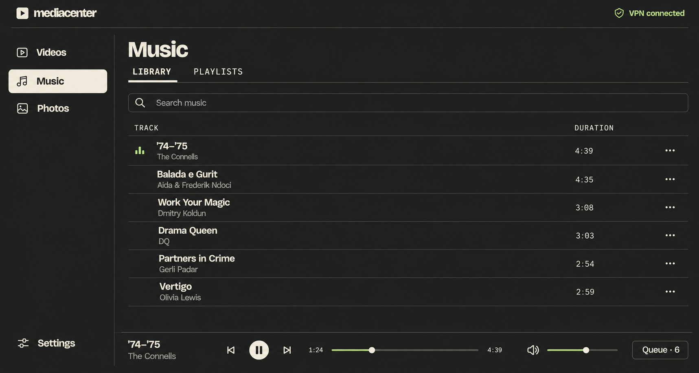
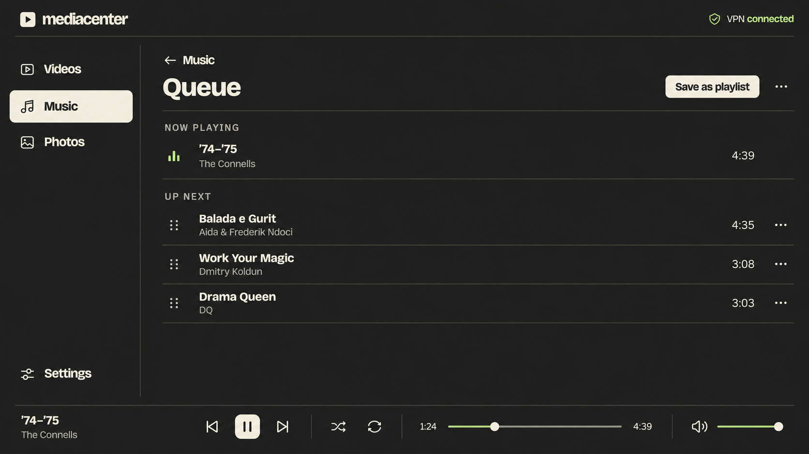
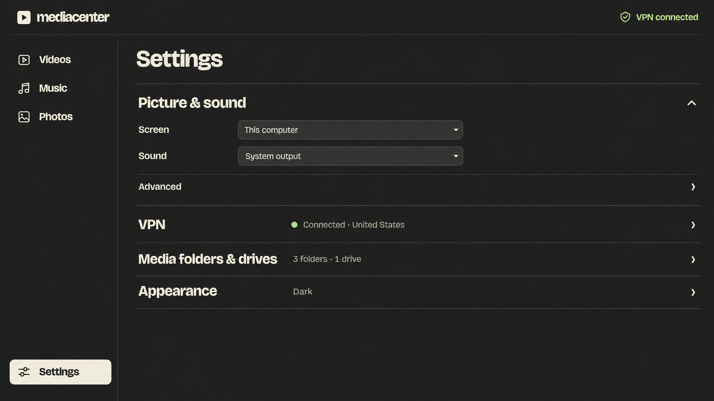

# Simplified Mediacenter concepts

Generated with the built-in Image Gen tool from the user's screenshots in `/home/emma/Pictures/references`. These are visual concepts, not implemented UI. Original app style is retained. Each function should have one clear location.

## Music library

## Queue

## Settings

## Generation prompts

### Music library

Use case: ui-mockup. Create one realistic production-quality UI redesign screenshot for the existing Mediacenter desktop app, faithfully retaining its existing visual identity. Target dimensions 1920 x 1080, 16:9 landscape. App content only, no Linux desktop taskbar, OS titlebar, browser chrome, device frame, annotations, concept titles or explanatory callouts. The supplied screenshots are actual visual reference inputs. Preserve the Bricolage Grotesque typography (bold tight headings and humanist body), warm charcoal background #202120, cream text #f1eddf, muted text #b0b0a6, subtle olive-gray dividers #3c4037, soft green #c1e895 only for active status. Outline icons 1.7px strokes. Cream rounded selected sidebar row; modest corner radii; no gradients, no decorative shadows, no new branding. Large readable 20px body text in this desktop composition, 48px screen title. Match the references' sparse flat utilitarian aesthetic, not a fashionable new dashboard. Use spacing and light horizontal separators rather than nested cards. Product goal: reduce clutter and remove duplicate places to perform the same action. Every control appears once. UI labels remain English, as in source. Current date 2026-11-09; no visible dates necessary.
Shared shell: slim header with original play-square logo and lowercase 'mediacenter' wordmark at upper left; small NONINTERACTIVE green shield and 'VPN connected' at far upper right. Absolutely no 'Picture & sound' button in header. Left sidebar about 270px wide, ONLY Videos, Music, Photos, and Settings, with original outline icons. No Home and no Drives & USB. Settings anchored lower, with generous blank space. Main starts around x=320. This is a mockup exploration, not code.

Direction name (not printed): Focused music library.
Primary reference image is the Music library screenshot; second is the existing queue screenshot for context.
Music selected in sidebar. Heading 'Music'. Under heading a narrow tab row with just 'Library' active and 'Playlists'. No Queue tab; queue has exactly one access point in the bottom player. One search field 'Search music' below tabs spanning most content width. Remove folder selection dropdown, Open folder, refresh button and SOURCE column. A spacious flat track list with header 'TRACK' and 'DURATION', about six rows. Use source music titles shortened to clean metadata: "'74–'75", "Balada e Gurit", "Work Your Magic", "Drama Queen", "Partners in Crime", "Vertigo"; durations 4:39, 4:35, 3:08, 3:03, 2:54, 2:59. Artist secondary muted text below each title: The Connells, Aida & Frederik Ndoci, Dmitry Koldun, DQ, Gerli Padar, Olivia Lewis. Each row has exactly ONE overflow ellipsis at far right for add-to-queue / playlist actions. No repeated + or play buttons on every row; clicking a title plays the track. The first playing row has a small soft green equalizer status icon and cream title.
One persistent bottom player across main content, separated by one thin rule, not a floating card: left current title "'74–'75" and muted "The Connells"; center previous, single cream pause button, next, plus thin progress line with 1:24 and 4:39; right one speaker volume icon and slider, and one text button 'Queue · 6'. Do not add duplicate controls. Generous calm negative space. Focus on music content, fewer visible UI elements, faithful original style.

### Queue

Use case: ui-mockup. Create one realistic production-quality UI redesign screenshot for the existing Mediacenter desktop app, faithfully retaining its existing visual identity. Target dimensions 1920 x 1080, 16:9 landscape. App content only, no Linux desktop taskbar, OS titlebar, browser chrome, device frame, annotations, concept titles or explanatory callouts. The supplied screenshots are actual visual reference inputs. Preserve the Bricolage Grotesque typography (bold tight headings and humanist body), warm charcoal background #202120, cream text #f1eddf, muted text #b0b0a6, subtle olive-gray dividers #3c4037, soft green #c1e895 only for active status. Outline icons 1.7px strokes. Cream rounded selected sidebar row; modest corner radii; no gradients, no decorative shadows, no new branding. Large readable 20px body text in this desktop composition, 48px screen title. Match the references' sparse flat utilitarian aesthetic, not a fashionable new dashboard. Use spacing and light horizontal separators rather than nested cards. Product goal: reduce clutter and remove duplicate places to perform the same action. Every control appears once. UI labels remain English, as in source. Current date 2026-11-09; no visible dates necessary.
Shared shell: slim header with original play-square logo and lowercase 'mediacenter' wordmark at upper left; small NONINTERACTIVE green shield and 'VPN connected' at far upper right. Absolutely no 'Picture & sound' button in header. Left sidebar about 270px wide, ONLY Videos, Music, Photos, and Settings, with original outline icons. No Home and no Drives & USB. Settings anchored lower, with generous blank space. Main starts around x=320. This is a mockup exploration, not code.

Direction name (not printed): One queue, one player.
Create the simplified QUEUE view, a focused listening queue opened from the music player's Queue button. Ground the style closely in screenshot 1, the old queue. Screenshot 2 is the old playlist editor; simplify its cumbersome playlist creation into one action on this queue.
Music selected in left sidebar. Main header has a small back arrow followed by 'Music', then large heading 'Queue' underneath. No Library / Playlists / Queue tabs on this nested view. Top right in same heading row exactly one cream action 'Save as playlist' and a quiet single ellipsis menu for queue-wide actions. This is the ONLY place to create a playlist from queued tracks, no separate playlist draft editor shown.
Below, one flat spacious list with 4 queued songs. Small muted label 'NOW PLAYING', a row with tiny green equalizer icon, "'74–'75" with muted "The Connells", duration '4:39'. Then muted 'UP NEXT' label and three rows: 'Balada e Gurit' / 'Aida & Frederik Ndoci' / '4:35'; 'Work Your Magic' / 'Dmitry Koldun' / '3:08'; 'Drama Queen' / 'DQ' / '3:03'. Each upcoming row has a small drag handle at left and only one overflow ellipsis at right. No per-row play, move-up, move-down, remove or track details buttons. No global Previous track, Next track, Refresh queue buttons. Generous dark blank space after the short queue.
At bottom one persistent player on flat surface separated by thin rule: current track and artist at left, previous / cream pause / next in center, shuffle and repeat outline icons once in this bar only, thin progress slider '1:24' and '4:39', speaker volume at far right. Do NOT show another Queue button while queue is already open; no duplicate playback actions elsewhere. Match original modest rounded rectangles rather than glossy styling. Visually calm, dramatically simpler than reference, one actual app screen with no annotation labels.

### Settings

Use case: ui-mockup. Create one realistic production-quality UI redesign screenshot for the existing Mediacenter desktop app, faithfully retaining its existing visual identity. Target dimensions 1920 x 1080, 16:9 landscape. App content only, no Linux desktop taskbar, OS titlebar, browser chrome, device frame, annotations, concept titles or explanatory callouts. The supplied screenshots are actual visual reference inputs. Preserve the Bricolage Grotesque typography (bold tight headings and humanist body), warm charcoal background #202120, cream text #f1eddf, muted text #b0b0a6, subtle olive-gray dividers #3c4037, soft green #c1e895 only for active status. Outline icons 1.7px strokes. Cream rounded selected sidebar row; modest corner radii; no gradients, no decorative shadows, no new branding. Large readable 20px body text in this desktop composition, 48px screen title. Match the references' sparse flat utilitarian aesthetic, not a fashionable new dashboard. Use spacing and light horizontal separators rather than nested cards. Product goal: reduce clutter and remove duplicate places to perform the same action. Every control appears once. UI labels remain English, as in source. Current date 2026-11-09; no visible dates necessary.
Shared shell: slim header with original play-square logo and lowercase 'mediacenter' wordmark at upper left; small NONINTERACTIVE green shield and 'VPN connected' at far upper right. Absolutely no 'Picture & sound' button in header. Left sidebar about 270px wide, ONLY Videos, Music, Photos, and Settings, with original outline icons. No Home and no Drives & USB. Settings anchored lower, with generous blank space. Main starts around x=320. This is a mockup exploration, not code.

Direction name (not printed): Settings in one place.
Primary reference is original Settings screenshot. Second reference is Drives & USB screen. Consolidate the scattered settings and folder management into one clear settings page, retaining exact same app style.
Settings selected in sidebar, no Home, no Drives & USB navigation. Main heading 'Settings'. Single column content around 1120px wide with substantial calm blank area below, NOT a dense two-column dashboard. Show exactly four accordion sections separated by thin rules, with only the first expanded.
Expanded section title 'Picture & sound', small upward chevron right. Within it only two aligned rows: label 'Screen' and compact dropdown 'This computer'; label 'Sound' and compact dropdown 'System output'. Beneath these one quiet collapsed text row 'Advanced' with right chevron (technical control screen mapping and connection details live inside). No Save target or Save selection button: dropdown choices apply immediately. No extra Picture & sound control in global header.
Then a collapsed full-width row: 'VPN', small green status dot and muted 'Connected · United States', right chevron. No country dropdown, disconnect, kill switch or refresh clutter until the section is expanded.
Then collapsed row: 'Media folders & drives', muted summary '3 folders · 1 drive', right chevron. This is the single place for media folder management and drive details; do not repeat those actions elsewhere.
Then collapsed row 'Appearance', muted summary 'Dark', right chevron. Diagnostics can live inside Advanced, don't add a fifth section.
The screen should visibly have dramatically fewer controls than source. Preserve cream text, charcoal flat surface, source heading weight, outline icons, original modest dropdown styling and generous whitespace. No floating cards, no new decorative icons, no explanatory paragraphs or callout annotations, no playback bar because nothing is playing in this mockup.

