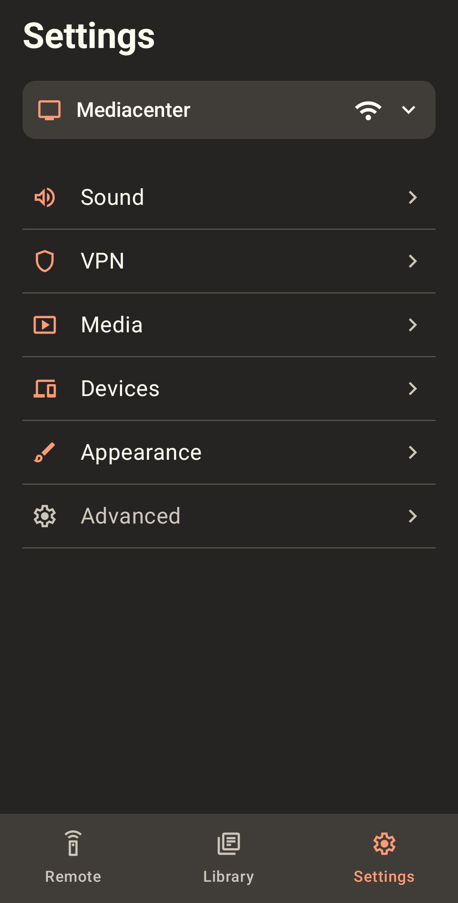

# Selected Settings redesign, 16 November 2026

Original Remote now uses source `d152ac0` (initial hierarchy `b9c4d37` plus final visual polish). The exact quiet-list concept selected by the user is implemented: Sound, VPN, Media, Devices, Appearance and Advanced, dedicated native pages, compact device selector and bottom navigation. The generated concept and actual phone captures were opened together in full-view and focused comparisons. Gear/brush/play-frame icons and 56dp/18sp row proportions fixed the initial P2 differences; the final comparison passed.

[Focused reference comparison](comparison-final-focus.png). Android-owned status/navigation bars are excluded from the public app-content capture. Complete private comparisons retain and identify real device chrome; no private media filenames were copied into public evidence.

447 unit/Compose tests pass, zero failures/errors/skips. Detekt, ktlint, Android lint and app/test APK builds pass. One process/session ended SIGTERM after all 447 results were written during lint; quality/package gates were rerun successfully, and the unit gate revalidated those completed results as up-to-date with successful exit. It did not redundantly rerun tests. The latest installed APK passed **29 actual Pixel tests in 37.336 seconds**.

All six sections opened in the original app. Visible back and Android Back returned to Settings; Devices opened connection setup and Appearance opened App theme/Done without changing preferences. Bottom destinations work. LG and Mediacenter both remain paired and connected; both target screens were inspected. The final Settings overview has six enabled, fully visible rows, one device name, no dot separators or inline technical guidance. [Geometry](physical-geometry.json).

Updated `com.emmah.colordock.remote`, label Remote, in place with the same signer and UID 10450. Both encrypted pairings and both original preference files matched byte-for-byte before first launch. Test runner removed; only original Remote remains. Font scale remains 1.15 and temporary USB stay-awake was restored to 0. Desktop, HDMI, sound volume and VPN settings were unchanged; no real playback/test sound or native settings/source/drive mutation was issued during UI verification.

Archive: `releases/remote-device-20261116/simple-settings-d152ac0/`, APK SHA-256 `164b6620fa80d4a56dd68785f445188c87176b649f11155a24682918e0cd1545`. SHA256SUMS verified. Earlier candidate folders remain immutable historical artifacts. This verifies the selected Settings redesign; full Task21/22 provider/lifecycle release acceptance remains partial.

Private source reference, first/final comparisons, raw phone screenshots, ledger, review, helper and installation proofs remain in `.superpowers/sdd/2026-11-16-simple-settings/`. Android root `design-qa.md` records passed visual QA. Current normal repositories/branches are retained; no push or merge was requested.
