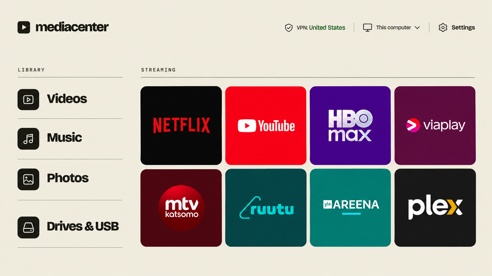
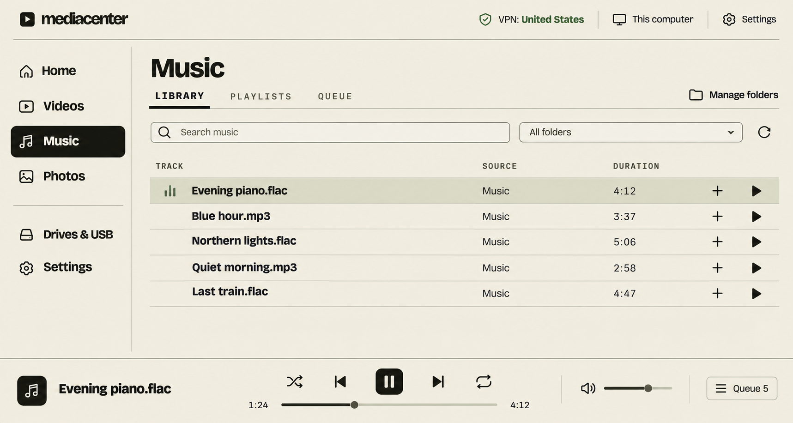
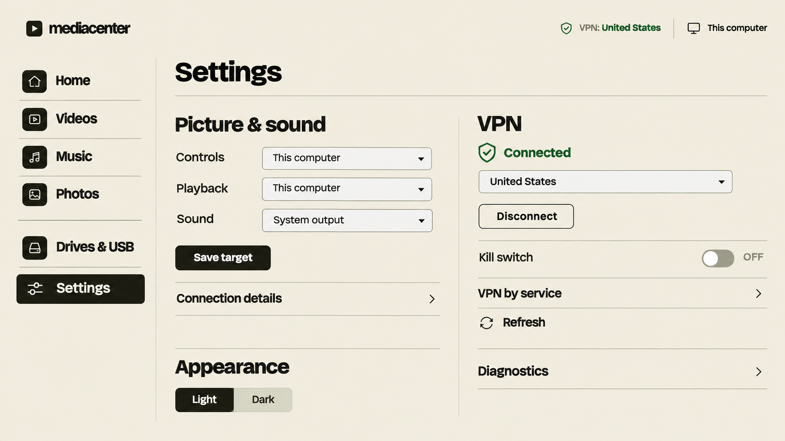
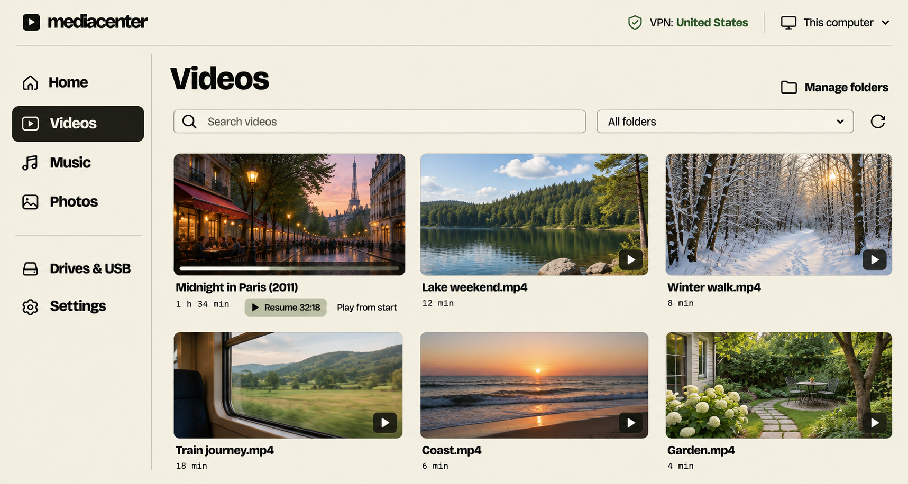
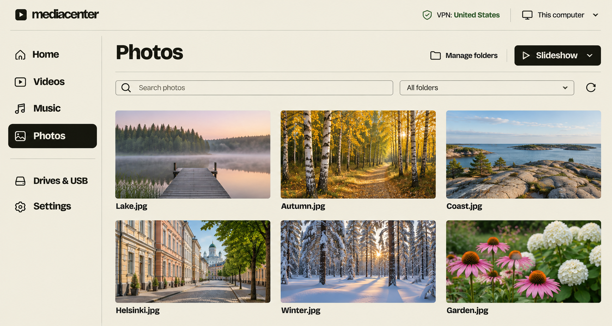
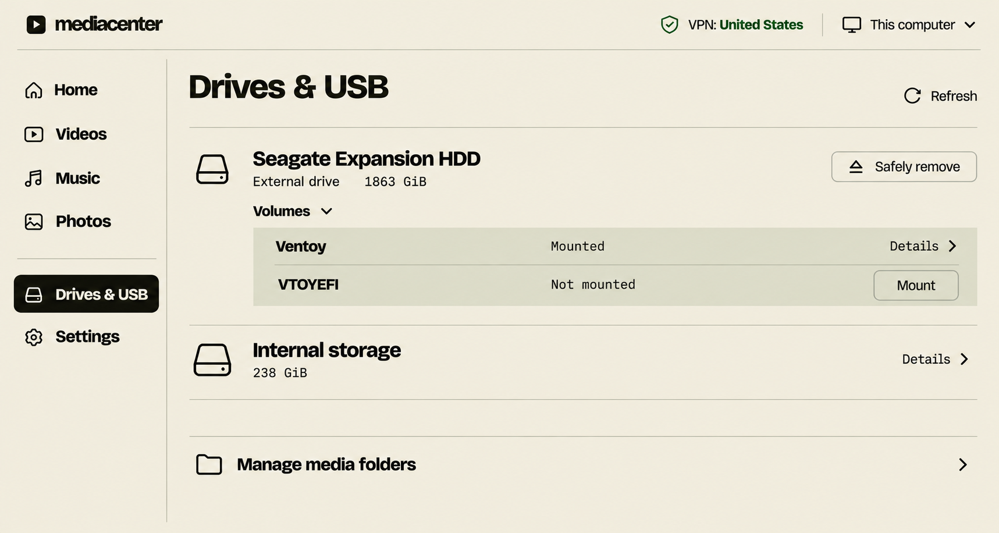

# Mediacenter Simplified Desktop UI Implementation Plan

> Execution record (6 November 2026): implemented on `codex/mediacenter-linux`. See [acceptance and remaining hardware checks](../../engineering/evidence/simplified-ui/acceptance.md), [visual exceptions](../../engineering/evidence/simplified-ui/visual-review.md), and [task ledger](../../engineering/evidence/simplified-ui/execution-record.md). The original checklist below is retained as the requested specification; the linked evidence records actual outcomes.

> **For agentic workers:** REQUIRED SUB-SKILL: Use superpowers:executing-plans to implement this plan task by task. Steps use checkbox syntax for tracking. Do not begin implementation merely because this document exists; the current request is to write the plan.
>
> **Visual requirement:** The six approved images below are implementation targets, not loose inspiration. A functionally correct application with a substantially different layout, typography, density, or hierarchy does not satisfy this plan.

**Goal:** Rebuild the presentation of all six Mediacenter screens to match the approved simplified mockups while preserving every existing media, playback, source, VPN, output, device, and exit capability.

**Architecture:** Keep the existing React/Tauri application, native commands, generated contracts, and persistent data. Introduce a shared desktop shell, persistent playback/source state, focused screen components, and accessible secondary panels. Use injected, development-only fixtures for deterministic screenshot review; the production application must always display real backend state.

**Tech Stack:** Existing locked React 19.3.1, TypeScript 6.0.3, Vite 8.3.6, Tauri 2.12.4 API, Rust backend, Vitest/Testing Library, and Playwright. Reuse locally bundled Bricolage Grotesque, IBM Plex Mono, and official service logos. No dependency upgrades or new UI framework are part of this work.

**Spec:** Sections 1–8 of this document are the detailed implementation specification. The visual sources are [the approved six-screen gallery](../../design/2026-11-06-simplified/index.html) and its PNG files. The [function-preservation notes](../../design/2026-11-06-simplified/README.md) supplement this specification. The older [desktop brief](../../design/2026-11-05-claude-visual-design-brief.md) supplies retained product constraints, but its earlier layout does not override the six new images.

**Repository inspection:** 6 November 2026; HEAD 6fa0e02. Recheck the working tree before execution. Existing changes in docs/engineering/streaming-compatibility.md and docs/engineering/evidence/viaplay-connection-comparison.md belong to separate work and must be preserved.

## Global Constraints

- Match the approved Colour Wall identity: warm ivory, near-black text, heavy compact headings, thin rules, restrained olive controls, and the original eight service colors.
- All controls remain on the computer. A television is an optional playback output, never the main control surface.
- The application remains a resizable Linux desktop window, including the existing 800 × 600 minimum and 1280 × 800 initial size.
- Preserve English interface labels from the images; this is not a localization project.
- Preserve all existing native capabilities and data. Do not reset the database, profiles, source grants, playlists, resume positions, theme, or VPN requirements.
- Keep all eight official service logos as real local assets. No generated replacements, repeated visible service captions, or logo distortion.
- No dot separators, decorative status balls, ellipsis menus, dot-based spinners, explanatory marketing copy, or routine technical telemetry on primary screens.
- Keep meaningful failure, offline, pending, unsaved, and partial-success states visible when they affect an action.
- Do not invent universal streaming search/history, recommendations, ratings, favorites, image editing, drive formatting, or file deletion.
- Do not change native command signatures or hand-edit src/app/contracts.ts to solve presentation problems.
- No fake successful state, assumed HDMI connection, assumed VPN country, or sample media in production.
- No package installation, real VPN changes, playback movement, or real drive removal is needed to implement and verify the browser UI. Native mutation checks belong to the controlled test session described in docs/engineering/verification.md.
- This plan specifies implementation work; writing it does not execute its commands or establish that its acceptance checks pass.

## Review Focus

Each item is assigned to explicit task checks below.

1. A delayed queue/player response arrives after navigation or a newer event: the visible state must not roll back, and navigation must not stop playback. Tasks 2 and 6.
2. A source goes offline during a search, thumbnail load, or slideshow: retain truthful availability and discard stale results without losing the selected source identity. Tasks 3, 5, and 7.
3. Saved playback target differs from actual picture/sound, or ordinary Chrome owns HBO playback: the compact header must not claim a move succeeded or offer unsupported control. Tasks 4, 8, and 10.
4. A removable device includes multiple volumes or shared physical drives and removal partially fails: confirmation covers the actual physical scope, and success is never fabricated. Task 9.
5. Long names, 200% text zoom, keyboard-only operation, or a small window: all important actions remain reachable, modal focus remains contained, and no content hides beneath the player. Tasks 1, 11, and 12.

---

## 1. Approved visual sources and precedence

### 1.1 Immutable source register

Keep these PNGs unchanged throughout implementation. Add implementation screenshots separately.

| ID | Screen | Approved file | Actual raster size | Primary visual requirements |
| --- | --- | --- | --- | --- |
| V1 | Home | [01-etusivu.png](../../design/2026-11-06-simplified/01-etusivu.png) | 1672 × 941 | Large brand, four personal-media rows, 4 × 2 service grid, compact connection header, no footer |
| V2 | Music | [02-musiikki.png](../../design/2026-11-06-simplified/02-musiikki.png) | 1717 × 916 | Sidebar, Library/Playlists/Queue tabs, compact track table, bottom player |
| V3 | Settings | [03-asetukset.png](../../design/2026-11-06-simplified/03-asetukset.png) | 1672 × 941 | Picture & sound left, VPN right, short controls, disclosure rows, Appearance and Diagnostics below |
| V4 | Videos | [04-videos.png](../../design/2026-11-06-simplified/04-videos.png) | 1717 × 916 | Three-column landscape thumbnails, short titles, per-video play/resume, compact toolbar |
| V5 | Photos | [05-photos.png](../../design/2026-11-06-simplified/05-photos.png) | 1717 × 916 | Large photo grid, Slideshow as a single main action, no always-open setup form |
| V6 | Drives & USB | [06-drives-usb.png](../../design/2026-11-06-simplified/06-drives-usb.png) | 1717 × 916 | Flat device rows, volume disclosure, whole-device eject, media-folder entry point |

The images were requested at 1920 × 1080, but the returned files have the sizes above. Use the actual raster sizes for direct comparison. Do not stretch them to 1920 × 1080 and call the distortion a requirement.

### 1.2 Images embedded for the implementer

**V1 — Home**

**V2 — Music**

**V3 — Settings**

**V4 — Videos**

**V5 — Photos**

**V6 — Drives & USB**

### 1.3 What must match and what must remain real

Match the composition, proportions, whitespace, type hierarchy, alignment, color, icon treatment, image-slot shape, and control placement. Populate these structures with actual media and device information at runtime.

The landscapes, filenames, durations, country, and connected devices shown in mockups are illustrative. Do not ship the generated Paris street as a purported frame from the user's movie. Use the real thumbnail service and real photo decoder.

Only the following reconciliations are permitted without proposing a different design:

1. **One inner-screen shell:** Use V4–V6 as the canonical shared sidebar/header geometry. V2 uses the same geometry. Normalize the slightly wider sidebar and black inactive icon tiles in V3 to that shared shell; retain V3's two-column content composition.
2. **Settings entry:** Show Settings in the Home header; show it in the sidebar on inner screens. Remove the duplicate Music header Settings entry.
3. **Official logos:** Use the repository's real logos, correcting any image-generator distortion. Preserve original brand geometry, including shapes inside trademarks.
4. **Flat surfaces:** Use the specified solid colors, not the slight paper grain or lighting artifacts generated in the mockups.
5. **Kill switch:** The current backend only enables it. The OFF control may enable it; the ON state must not promise a disable operation that does not exist. See section 5.5.
6. **Truthful states:** Error/pending/offline/dirty-state content may add a small contextual row when necessary. It must not restore the old always-visible paragraphs.
7. **Capacity and metadata:** Only display actual contract fields. Do not infer free disk space, full-device capacity from incomplete partition data, or absent media duration.

Every other significant visual departure requires a documented reason and review. Do not use “responsive design” to justify changing the approved wide-screen layout.

## 2. Current implementation and change boundaries

### 2.1 Existing ownership

| Existing file | Current responsibility | Required change |
| --- | --- | --- |
| src/app/App.tsx | Home subscription, route state, theme, service launch, video launch | Keep orchestration; replace separate shells and long inline conditional markup with shared layout and explicit screens |
| src/ui/AppShell.tsx | Brand, verbose connection fields, repeated footer | Compact actionable header, inner sidebar, screen area, conditional player slot |
| src/ui/theme.css | Tokens plus nearly all global component styles | Preserve token identity; organize scoped shell and feature styles; remove conflicting old layout rules after migration |
| src/features/home/HomeScreen.tsx | Five personal rows and service tiles | Four personal entries, Settings in header, no summary paragraphs |
| src/features/library/MediaBrowser.tsx | Query/filter/list/preview plus embedded SourcePicker | Share query controller; render screen-specific content; move folder management out of main content |
| src/features/library/SourcePicker.tsx | Choose/add/scan/cancel/remove roots | Reuse operations in a shared folder sheet; preserve operations across navigation |
| src/features/music/MusicScreen.tsx | Queue, playlists, editor, library, player stacked together | Three tabs, library-first table, separate playlist editor, persistent player |
| src/features/player/LocalPlayerControls.tsx | Player event subscription and all controls | Shared player state; compact bar plus secondary full controls |
| src/features/photos/PhotosScreen.tsx | Search/grid, slideshow form, viewer and sources | Image-first grid, setup sheet, viewer dialog, active-session controls |
| src/features/photos/PresentationScreen.tsx | Restricted display-only presentation window | Preserve isolation; only adapt styles if required |
| src/features/drives/DrivesScreen.tsx | Device/volume lists, mount/eject confirmation, sources | Flat device rows with disclosures and focused confirmation |
| src/features/outputs/OutputSettings.tsx | Control display, desired target, actual state, move/recover | Compact rows and explicit distinctions between save and move |
| src/features/vpn/VpnSettings.tsx | Countries, connect/disconnect, enable Kill switch, service requirements | Compact status/action group and per-service sheet |
| src/features/settings/Diagnostics.tsx | Report preview/export | Open from a disclosure row, not permanently expanded |
| src/features/settings/ExitDialog.tsx | Native exit decisions | Retain native policies and restyle with shared accessible dialog |
| src/features/streaming/StreamingSession.tsx | Explicit managed-service window controls | Reachable compact secondary panel; retain ordinary-Chrome exception |

The inspected version is 0.1.3. The old geometry test compares the app against the 5 November HTML design. It will need replacement because it asserts the design this work intentionally supersedes.

### 2.2 Native and persistence boundaries

Retain backend.ts, musicApi.ts, photos/api.ts, drives/api.ts and their native command semantics. Thin event and diagnostics adapters may be extracted for injection; this is not a native rewrite.

In particular:

- performOperation waits for operation_finished. Keep its operation-ID matching, early-event buffering, cancellation-on-timeout behavior, and cleanup.
- subscribeHome uses revision-aware state and gap refresh. Do not replace it with unguarded polling.
- Music mutations pass the displayed queue sessionId and revision.
- Source registration uses a short-lived SourceGrant; never turn a display path into an authorized root.
- PlaybackTarget stores monitorId/audioSinkId, with null representing the existing computer/system default.
- Presentation capability remains separate from the main window. Do not mount the main services provider or navigation in the presentation window.
- Existing source ownership, safe raster handling, drive identities, permissions, session ownership, and exit behavior remain intact.
- No Rust contract change is expected. If one proves unavoidable, document why, change the Rust definition, regenerate with the repository's export-contracts example, and add native checks. Never manually patch generated TypeScript.

## 3. Design system and geometry contract

### 3.1 Colors and typography

Use the existing semantic variables rather than hardcoding light colors throughout components.

| Token | Light | Dark |
| --- | --- | --- |
| --surface | #f1eddf | #202120 |
| --page | #e0dfd7 | #111214 |
| --ink | #191912 | #f1eddf |
| --muted | #626256 | #b0b0a6 |
| --rule | #5e6052 | #56584f |
| --border | #c5c6b5 | #3c4037 |
| --soft | #dbdccc | #32352e |
| --hover | #e5e3d5 | #2b2d29 |
| --active | #285a28 | #c1e895 |

The complete app canvas uses --surface. There is no centered outer “app card,” desktop wallpaper, or shadow around the application.

Typography starting values at the reference widths:

| Element | Font | Size / line height | Weight |
| --- | --- | --- | --- |
| Inner-screen brand | Bricolage Grotesque | 34 / 38 px | 800 |
| Home brand | Bricolage Grotesque | 46 / 52 px | 800 |
| Page title | Bricolage Grotesque | 56 / 62 px | 800 |
| Settings section title | Bricolage Grotesque | 38 / 44 px | 800 |
| Sidebar label | Bricolage Grotesque | 28 / 34 px | 700 |
| Home personal-media label | Bricolage Grotesque | 40 / 46 px | 800 |
| Media/track title | Bricolage Grotesque | 22 / 28 px | 700 |
| Control text | Bricolage Grotesque | 20 / 26 px | 500–600 |
| Secondary text | Bricolage Grotesque | 18 / 24 px | 400 |
| Tabs/section labels | IBM Plex Mono | 16 / 22 px | 600 |
| Duration/compact metadata | IBM Plex Mono | 16 / 22 px | 400 |

Use roughly -0.04em for major headings and -0.06em for the wordmark; do not tighten normal form text. Section labels may use 0.12em tracking. All fonts load from public/fonts; keep startup theme initialization before paint.

These are implementation starting values chosen from the approved images, not permission to ignore screenshot comparison. Adjust a shared token when comparison identifies a measurable discrepancy; record the final token values in the visual evidence.

### 3.2 Canonical inner-screen frame

At 1717 × 916 CSS pixels, device scale factor 1:

- Header occupies approximately y=0–88; horizontal rule at y=86. Outer horizontal padding 30 px.
- Brand begins around x=44, y=28. Status controls align to the right and occupy one line.
- Sidebar occupies x=0–286 below the header. Vertical rule is near x=286.
- Sidebar buttons have 24 px left inset, approximately 248 px width, 68 px height, 12 px corner radius, and 8 px vertical separation.
- Home/Videos/Music/Photos form the upper group. A divider and about 36 px of separation precede Drives & USB and Settings.
- Main content begins at x≈324 and ends at x≈1687, giving 36–38 px left padding and 30 px right padding.
- Page title top is y≈120, with toolbar/action rows in the y=190–270 range.
- The video/photo grid uses three equal columns, approximately 434–440 px wide, 28–32 px horizontal gaps, and 16:9 images.
- In V2 the player begins at y≈776 and occupies the remaining 140 px; its top rule spans the whole window, including below the sidebar.
- No routine footer. Reserve bottom space only while a real audio/video/slideshow session needs a persistent strip.

Use CSS Grid for the shell with auto header, minmax(0,1fr) workspace, and auto player rows. Workspace contains sidebar plus minmax(0,1fr) content. Use one main-content scrolling region. Sidebar may scroll independently at small heights; modal sheets get their own internal scroll region. Avoid competing nested scrollbars within tables and grids.

### 3.3 Home geometry

At 1672 × 941:

- Header brand approximately x=60, y=72; connection controls occupy the upper-right.
- Content begins near y=230, with 60 px outer margins.
- Personal column approximately 356 px wide; service content starts near x=478.
- Service region is four equal columns and two rows; gaps approximately 12–16 px.
- Tiles are approximately 276 × 270 px in this reference, with 18–20 px corner radii.
- Keep the grid and four personal rows balanced vertically. Do not fill unused space with counts or summaries.
- The left rows are Videos, Music, Photos, Drives & USB. Labels have no second explanatory line.
- Home does not use the inner-screen sidebar. It retains the distinct approved landing composition.

### 3.4 Shared controls

- Standard controls: 44–48 px high, 8 px radius, 1 px border. Important black buttons use --ink with --surface text.
- Icon-only controls: at least 44 × 44 px hit area; visible icon 22–28 px. Sidebar icons 30–34 px.
- Preserve the existing outline icon language; extend the local icon set, do not import a visually unrelated icon package.
- Hover uses --hover or a restrained border change. Focus uses an external 3 px high-contrast outline without changing layout.
- No full-width fields unless the composition calls for them; settings labels and compact selectors align in rows.
- Prefer normal <button>, <input>, <select>, 
, 
, and <dialog> semantics. Do not render inert div controls.
- Use line/chevron disclosures and the labels shown in the PNGs. No three-dot menus.
- No nested clickable elements. Separate a thumbnail-preview button from play/resume buttons.
- Truncate long filenames visually using clipping/fade rather than a literal ellipsis glyph; expose the complete name in an accessible label and keyboard-accessible details.
- Sliders may use a small rounded-square thumb, consistent with the repository's no-added-dot rule; do not change the rule checker merely to allow decorative circular controls.
- Loading uses a short status label or static skeleton, respecting reduced motion.

### 3.5 Responsive behavior

Define breakpoints against the app viewport, not a phone-first redesign.

| Width | Shell and content |
| --- | --- |
| ≥1440 px | Reference composition; inner sidebar 286 px; three media columns; Settings two columns; Home four service columns |
| 1100–1439 px | Sidebar 232 px; 28 px content padding; page title 44 px; labels 22 px; three media columns; Settings remains two columns if each column is at least 360 px |
| 900–1099 px | Sidebar 204 px; 24 px content padding; title 38 px; two media columns; Settings one column; Home uses two service columns |
| 800–899 px | Sidebar 176 px with 18 px labels; content padding 20 px; two media columns when each can remain at least 240 px, otherwise one; status controls can wrap |
| Text zoom / constrained height | Allow wrapping and vertical scrolling; do not shrink text below 16 px or hide actions to preserve a screenshot |

At 1280 × 800 the result must look like a proportional desktop adaptation, not a squeezed 1717 px screenshot. The player may use two rows under 1100 px. Controls must never be covered by a fixed bar. Keep all labels visible; do not collapse to unexplained icon-only navigation.

Dark theme uses the same structure and hierarchy. The approved PNGs establish the light target; adapt using existing dark tokens and separately inspect contrast. Do not invent a new dark visual direction.

## 4. Navigation, state ownership, and secondary surfaces

### 4.1 Route model

Retain the domain names home, video, audio, photo, drives, settings. Keep streaming and player as auxiliary routes for complete existing controls. Do not add a routing library.

Add src/app/navigation.ts:

~~~ts
export type MainScreen = 'home' | 'video' | 'audio' | 'photo' | 'drives' | 'settings';
export type AppRoute = MainScreen | 'streaming' | 'player';
export type MusicTab = 'library' | 'playlists' | 'queue';
export type SettingsSection = 'outputs' | 'vpn' | 'appearance' | 'diagnostics';

export interface NavigationState {
  route: AppRoute;
  musicTab: MusicTab;
  settingsSection: SettingsSection | null;
}
~~~

Keep navigation state in MainApp. Going Home does not stop any session. Music re-entry preserves its selected tab within the application session. Initial Music entry selects Library. A Queue action sets route=audio and musicTab=queue. A header VPN action sets route=settings and settingsSection=vpn; focus the appropriate section after render. Output header action similarly targets outputs.

Active sidebar state for player is Videos for a local-video session and Music for local-audio. Streaming controls have no false selected library item; Home remains available.

### 4.2 Shared shell interface

Modify AppShell and add Sidebar/PageHeader:

~~~ts
export interface AppShellProps {
  snapshot: HomeSnapshot;
  route: AppRoute;
  onNavigate: (screen: MainScreen) => void;
  onOpenSettings: (section?: SettingsSection) => void;
  children: React.ReactNode;
  player?: React.ReactNode;
}
export interface PageHeaderProps {
  title: string;
  actions?: React.ReactNode;
}
~~~

AppShell renders the single header, sidebar only outside Home, and optional persistent player. Screens do not wrap themselves in additional AppShell instances. Replace the current duplicate shell composition in HomeScreen/App.tsx.

### 4.3 Shared sheets/dialogs

Create src/ui/Sheet.tsx and src/ui/Dialog.tsx. Both use one focus-management implementation based on native dialog where supported by the current WebKitGTK; verify behavior in the native renderer.

~~~ts
export interface SheetProps {
  open: boolean;
  title: string;
  onRequestClose: () => void;
  children: React.ReactNode;
  footer?: React.ReactNode;
  initialFocusRef?: React.RefObject<HTMLElement | null>;
  busy?: boolean;
}
~~~

- Sheet: right aligned, 520 px wide at large widths, maximum min(640 px, viewport minus 32 px), full height within the app.
- Confirmation dialog: centered, width min(520 px, viewport minus 32 px).
- Photo viewer: larger dialog, width min(1200 px, viewport minus 48 px), image area constrained by available height.
- Surface uses --surface and --border; backdrop black at approximately 25% opacity.
- Show heading and explicit Close button. Trap focus, make background inert, restore focus to opener.
- Escape and backdrop request closure through onRequestClose. They must not bypass dirty-draft confirmation or interrupt an irreversible native action.
- Do not stack several sheets. A confirmation temporarily owns focus above its parent; closing it returns to that parent.
- Opening/closing a sheet is not a backend operation. Never cancel a scan, stop music, or change VPN because a panel unmounted.
- Busy state prevents duplicate mutation, but Cancel scan remains available while a scan is running.

Secondary surfaces do not have approved images. Derive their typography, controls, spacing, and palette directly from V3/V6, and keep them limited to the selected task.

## 5. Screen-by-screen behavior

### 5.1 Home — V1

Visible default content:

- Brand, compact VPN status, compact playback output, Settings action.
- LIBRARY label above Videos, Music, Photos, Drives & USB.
- STREAMING label above all eight logo-only buttons.
- No media counts, resume paragraph, connection explanations, repeated footer, or empty-state copy.

Service order and colors are fixed:

| Row | Service IDs in order | Colors |
| --- | --- | --- |
| Top | netflix, youtube, hbo_max, viaplay | #080808, #f90018, #46018a, #600c41 |
| Bottom | mtv_katsomo, ruutu, yle_areena, plex | #4e0710, #063f40, #00796f, #151515 |

Use source service definitions for accessible names and logoAsset. Clicking a tile still calls backend.openService(serviceId), including reopening and switching. Do not replace it with focusSession or a new intermediate service screen.

Show service launch errors adjacent to the service region. Show a small Playback controls action only for an actually managed streaming session. Preserve the existing HBO ordinary-Chrome message and do not offer managed output controls for an unmanaged window.

### 5.2 Videos — V4

Header: Videos; Manage folders on the right. Toolbar: Search videos, All folders, Refresh library icon.

- Query kind=video with 200 ms debounce, maximum 200 query characters, existing 50-item cursor pages.
- Grid thumbnail shows actual backend.thumbnail(mediaId), cropped with object-fit:cover in a 16:9 slot. On failure use a quiet video icon and filename, not an unrelated stock image.
- Filename/title is one or two bounded lines under the thumbnail. Duration comes only from durationMs; omit when null.
- For an available item without resume position: show Play.
- For an available item with resumePositionMs>0: show Resume m:ss and Play from start. Position is clamped to known duration for display only.
- Play maps to backend.playMedia(item.id,false); Resume maps to true. Route to existing player controls after successful launch.
- A thumbnail/title opens a preview dialog; it does not unexpectedly start playback. Play buttons are separate targets.
- A progress strip is shown only for valid known duration and resume position.
- Offline/missing item remains identifiable with short status and disabled playback. It is not silently removed.
- Show Previous/Next only when cursor navigation is relevant; do not fabricate total counts.
- Empty unconfigured library: “No videos yet” plus Add folder. Existing sources with no results: “No matching videos” plus Clear search when applicable.
- Manage folders opens the common sheet filtered to video. It is absent from the main grid's vertical content.

### 5.3 Music — V2

Header: Music. Under it, Library / Playlists / Queue tabs and Manage folders. Keep the selected underline and monochrome uppercase label treatment.

**Library tab**

- Search music, All folders, refresh icon.
- Semantic table with Track, Source, Duration. Track uses MediaItem.displayName; Source resolves sourceId against MediaSource.label; duration uses durationMs.
- Each row has distinct Add to queue and Play actions with item-specific accessible names.
- The current item may have a muted olive highlight and equalizer line icon.
- Do not show artist/album/availability as repeated paragraphs on every library row.
- Preserve real artist/album metadata in Queue/playlist item details if available; no loss of existing data.
- No album art catalogue, favorites, or invented metadata.

**Persistent player**

- Shown for real local-audio playback across Home and all inner routes, not only Music.
- Left: music icon and current title; center: Shuffle, Previous, Play/Pause, Next, Repeat; time/seek below; right: Mute/Volume and Queue N.
- State comes from player and music queue observations, not from the currently mounted MusicScreen.
- Repeat cycles off → all → one → off; icon treatment and accessible label expose the actual mode.
- Time format m:ss or h:mm:ss. Unknown duration disables seek and does not render NaN or fabricated length.
- Stop and advanced audio/subtitle controls remain reachable through the current-track control opening the full Local playback panel; do not remove these because V2 does not show them.
- Handle seek drag locally; send once on pointer release or keyboard commit. Ignore stale time updates while dragging, then reconcile.
- Coalesce volume changes during drag and guarantee the final chosen value is sent. The current “ignore while busy” pattern must not drop the user's final value.
- Queue count is queue.items.length, including unavailable entries. No bar when no audio session exists.
- A local-video session uses its own compact playback strip and full control panel, not music-specific queue actions.

**Queue tab**

- Show ordered entries keyed by QueueEntry.entryId, not by mediaId (duplicates are allowed).
- Selecting a row exposes Play, Move up, Move down, Remove; provide keyboard-accessible controls without relying on drag and drop.
- Keep previous/next, shuffle/repeat through the shared player. Refresh queue and Save as playlist remain available.
- Preserve 50-entry pagination and global indices across pages.
- Mutations use the displayed sessionId and revision; refresh after a rejection and retain the original error.

**Playlists tab and editor**

- Compact list with name, track count, Play, Edit, and Delete.
- New playlist starts a draft; Save queue as playlist prepopulates it. Append queue appends in order, preserving duplicates.
- Editing uses a draft separate from playback queue. No save occurs before explicit Save playlist.
- Name must be nonempty after trimming and at most 200 Unicode code points; maximum 10,000 items.
- Reorder/remove are draft operations. A short unsaved indicator appears only when dirty.
- Switching tabs, changing route, Escape, or closing the editor with dirty changes uses Save / Discard / Cancel confirmation.
- Delete playlist removes playlist metadata only. Removing a track does not delete the media file.

### 5.4 Photos — V5

Header: Photos; Manage folders and black Slideshow button on the right. Toolbar: Search photos, All folders, refresh.

- Three-column 16:9 thumbnail grid at reference width. Thumbnail crop may use cover; opened image always initially uses contain.
- Each tile shows its filename below. No per-photo status/date paragraph unless a problem needs explanation.
- Query and source semantics match Videos. Use photosApi.image only for the opened viewer, not for all thumbnails.
- Opening a photo moves focus into the viewer. Fit / Actual size / Close are retained. Actual size means the decoded image's pixel dimensions; the existing decoder caps images at 1920 × 1080, so do not imply original-file resolution.
- Modified date and decoded dimensions move into a Photo details disclosure in the viewer.
- A stale load for photo A must not replace photo B after rapid selection.

**Slideshow setup sheet**

- Slideshow opens setup; it must not immediately launch a presentation.
- Fields: Display; Seconds per photo (integer 1–60, default 5); Shuffle photos.
- Start slideshow is the only primary action. Use the current source/search filter, traversing all cursor pages, selecting only available photos.
- Enforce at most 10,000 photos, including the exact-boundary case where another cursor still exists. Show the existing narrowing requirement if exceeded.
- Submit one SlideshowRequest with mediaIds, monitorId|null, intervalSeconds, shuffle.
- No active photo IDs, path access, or source scanning may be inferred from a decorative thumbnail.

**Active slideshow**

- Slideshow button becomes Show slideshow controls. A compact persistent strip keeps the active presentation reachable after navigation.
- If music and a slideshow coexist, reserve two compact shell rows rather than overlaying one on the other: the audio player remains the bottom row, and the slideshow status/control row sits immediately above it. Each Stop action identifies and affects only its own session. With neither active, both rows disappear; the approved idle layouts keep their full content height.
- Show photo index/total, Previous, Pause/Resume, Next, Stop. Interval/shuffle/Fit/Actual size remain in the control sheet.
- On display_missing, show the recovery action Continue on computer, keep Stop available, and do not silently move presentation.
- Preserve the display-only PresentationScreen and restricted capability. No sidebar/header/player or main IPC imports there.
- Poll snapshot at the existing 1000 ms cadence, serially; presentation frame polling stays 500 ms. Avoid overlapping polls and discard responses older than the latest user action.

### 5.5 Settings — V3

Use a two-column content layout with generous central gap. At widths where it cannot fit, stack the same groups. Do not replace it with a giant accordion or a full-width form.

**Picture & sound**

Three label/control rows: Controls, Playback, Sound.

- Controls is the computer's control monitor, from OutputList.computerMonitorId. Changing it explicitly calls backend.setControlMonitor(id) immediately, then refreshes outputs. Indicate saving/failure beside the row. This does not move a media session.
- Playback and Sound are a local desired-target draft initialized from OutputSnapshot.desired.
- Save target calls backend.selectOutput({monitorId,audioSinkId}) only. It never calls moveSession.
- Keep Save target exactly as in the image. On focus/help, explain the different Controls immediate-save behavior concisely rather than adding another permanent button.
- If playback is active, expose Move playback and Bring back to computer in the output sheet or a compact active-session row. These are distinct explicit actions.
- Missing/disconnected options remain visible and disabled with short status; do not silently select another output.
- Connection details opens actual effective display/audio, saved target, output state, Refresh outputs, and relevant backend errors.
- Header display describes verified output state. A saved HDMI target is not enough to label picture/sound “ready.” If actual state is unresolved, show an honest compact label and expose details.

**VPN**

- Use useVpnObservation and its 10,000 ms freshness rule. Never display a stale connected country as green.
- Connected: shield, Connected, country control, Disconnect.
- Disconnected: country control and Connect.
- Selecting a different country while connected must not silently change the network. Expose Apply country while the draft differs; invoke backend.connect(selectedCountry) only on that explicit action.
- Connecting/disconnecting: brief pending label, mutation controls disabled until terminal completion.
- Unknown/unavailable/error: appropriate short status and Refresh; no fake connection.
- The country list comes from backend.countries; preserve provider-recommended null selection.
- Kill switch uses the mockup's compact row and state indicator. If disabled, activation calls enableKillSwitch. If enabled, show ON read-only; help text on focus explains management in NordVPN. There is no disable API. Unknown is not rendered as OFF.
- A short on-demand help disclosure explains that network changes affect the computer and other apps; do not remove this consequential information entirely.
- VPN by service opens all eight requirement switches. Saving a requirement calls setVpnRequirement(id,required), not connect/disconnect. Failure retains actual state and shows an error.
- Refresh remains available when no conflicting operation is running.

**Appearance and Diagnostics**

- Light/Dark segmented control calls the existing theme handler and persists through the native backend/local startup mechanism.
- Theme success must not be claimed on native failure.
- Diagnostics row opens a sheet with Preview and export. Keep the existing sanitization boundaries and native save dialog.
- Do not keep JSON, dependency versions, or privacy paragraphs on the main Settings page.

### 5.6 Drives & USB — V6

- Header: Drives & USB, Refresh at right.
- External devices appear as flat rows. Prefer the actual device name; show External drive and a compact known capacity summary.
- Current contracts provide per-volume size, not physical drive capacity or free space. Use a truthful label such as “1863 GiB in volumes” when aggregating unique known volumes; expose exact per-volume sizes in details. Never invent a used/free bar.
- Whole-device Safely remove action aligns at the right. No eject button for internal storage.
- Volumes disclosure expands the shared lightly tinted area, not one card per partition.
- On the first successful load, expand the first removable device's Volumes section to match V6; keep other devices collapsed. Preserve user expansion choices by drive.id across refreshes, and remove state only when that device disappears. A refresh must not repeatedly reopen a section the user closed.
- Volume rows show label, Mounted/Not mounted, and Details or Mount when applicable.
- Details contains mountPoints, volume size, identity information and ambiguity. Ambiguous identities must visibly block unsafe actions rather than looking normal.
- Internal storage is a compact row with Details. If multiple internal drives exist, distinguish them by actual name/details; do not merge unrelated devices.
- Manage media folders opens the same source sheet without a media-kind filter.

**Safe removal workflow**

1. Safely remove calls drivesApi.prepare(drive.id).
2. Display a compact confirmation identifying every preview.driveNames entry and activeUses; state whole-device scope, including sibling drive IDs.
3. Confirm calls eject(drive.id, preview.driveIds) using the exact confirmed set.
4. Keep the current backend policy of stopping owned playback/slideshows/scans/loads before removal.
5. During the operation, prevent duplicate submission and preserve truthful pending state.
6. On success, refresh drives and sources. Distinguish powered_off from unmounted; never say powered off for the latter.
7. On failure, refresh observations if possible, show the error and current state, and do not display Safe to remove.
8. Cancelling before confirmation performs no eject. Never mount/eject as a side effect of expanding a row.

### 5.7 Shared folder manager

Primary screens show only Manage folders / Manage media folders / Add folder where relevant.

The sheet contains:

- Add folder, invoking the existing native chooser.
- Pending grant path and selectable Videos/Music/Photos kinds; default to the calling screen's kind or all three from Drives.
- Add selected folder and Cancel. Cancelled chooser or expired grant does not register a root.
- Compact source rows with name and availability; path and supported kinds in Details.
- Scan, Cancel scan while an owned scan is pending, and Remove from library.
- Removal confirmation explains “Files stay on disk.” No file-delete operation is introduced.
- A completed add does not silently claim indexing succeeded. Offer Scan or show unindexed state until actual scanning completes.
- On change, invalidate matching source/library queries and reset invalid cursors.
- Source IDs remain stable through mount-path changes; do not key persistence on displayed paths.

Own scan promises and errors above the sheet's lifecycle. Closing the sheet or switching screens must not hide an active scan's Cancel action permanently. Maintain a sourceId-keyed pending registry for scans started in this process, and show their status when reopened.

The present API does not expose a general scan-state query. Do not invent progress percentages or assume no background scan exists after reconnect. Preserve an explicit Cancel scan recovery action in source Details for this uncertain case.

## 6. Component and file architecture

Keep the changes inside the existing frontend. Do not create a second prototype app or ship mockup screenshots as the actual UI.

### 6.1 Planned files

| File(s) | Responsibility |
| --- | --- |
| src/app/navigation.ts | Shared route/tab/section types |
| src/app/AppServices.tsx | Typed runtime dependency context, production implementations by default |
| src/app/App.tsx | Main orchestration and DEV-only fixture bootstrap |
| src/ui/AppShell.tsx, Sidebar.tsx, PageHeader.tsx | Shared frame and navigation |
| src/ui/Sheet.tsx, Dialog.tsx, IconButton.tsx | Accessible secondary surfaces and icon controls |
| src/ui/Icons.tsx | Existing-family line icons, missing control glyphs |
| src/ui/theme.css, shell.css, controls.css | Semantic tokens, shell/responsive layout, common controls |
| src/features/home/HomeScreen.tsx, PersonalMediaRow.tsx, home.css | V1 composition |
| src/features/library/useMediaLibrary.ts | Search/source/cursor state and stale-response protection |
| src/features/library/LibraryToolbar.tsx, LibraryPagination.tsx, MediaThumbnail.tsx | Shared media-view controls and lazy thumbnails |
| src/features/library/FolderManager.tsx, SourceManagerProvider.tsx, library.css | Source operations, persistent pending registry, source sheet |
| src/features/library/SourcePicker.tsx | Adapt existing source operations for FolderManager; remove long inline presentation |
| src/features/videos/VideosScreen.tsx, VideoCard.tsx, videos.css | V4 and preview/resume entry points |
| src/features/player/playerApi.ts, PlaybackProvider.tsx, PlayerBar.tsx, player.css | Event adapter, shared observations, persistent strip |
| src/features/player/LocalPlayerControls.tsx | Full secondary player controls using shared state |
| src/features/music/MusicScreen.tsx, MusicLibrary.tsx, MusicQueueView.tsx, PlaylistList.tsx, PlaylistEditor.tsx, music.css | V2 and its secondary tabs/editor |
| src/features/photos/PhotosScreen.tsx, PhotoViewer.tsx, SlideshowProvider.tsx, SlideshowControls.tsx, photos.css | V5, viewer, persistent slideshow state |
| src/features/outputs/OutputSettings.tsx | Compact rows and Connection details |
| src/features/vpn/VpnSettings.tsx | Compact VPN block and service sheet |
| src/features/settings/SettingsScreen.tsx, settingsApi.ts, Diagnostics.tsx, ExitDialog.tsx, settings.css | V3, diagnostics adapter, shared dialog styling |
| src/features/drives/DrivesScreen.tsx, DriveRow.tsx, EjectDialog.tsx, drives.css | V6 and confirmation |
| src/features/streaming/StreamingSession.tsx | Compact preserved session-control route |
| src/testing/redesignFixtures.ts, fixtureServices.ts | DEV-only deterministic fixtures and fake API behavior |
| tests/fixtures/redesign/ | Small static image fixtures and their provenance |
| tests/visual/redesign.spec.ts | Six-screen reference comparisons and viewport states |
| tests/e2e/redesign.spec.ts | Complete browser workflows with fake services |
| tests/unit/*.test.tsx | Meaningful behavior and regression coverage identified below |

Do not create empty scaffolding files just to satisfy this table. Add each file when its owning task implements its responsibility. Avoid exporting presentation-only helpers unnecessarily.

### 6.2 Typed dependencies

Keep optional per-component API injection used by current tests, but default to the shared services context instead of unconditional global imports.

~~~ts
export interface AppServices {
  backend: typeof backend;
  music: typeof musicApi;
  photos: typeof photosApi;
  drives: typeof drivesApi;
  player: typeof playerApi;
  settings: typeof settingsApi;
  subscribeHome: typeof subscribeHome;
  canUseMedia: boolean;
}
~~~

- Production canUseMedia is isTauri(). DEV fixtures explicitly provide true without native IPC.
- An ordinary production browser launch still shows the existing desktop-only limitation; do not treat every browser as a simulated native environment.
- playerApi.observe(update): Promise<() => void> subscribes before fetching the initial backend.player snapshot, guards late responses, and cleans up on failure.
- playerApi commands continue through backend.controlPlayer; the adapter exists for observations, not a second command authority.
- settingsApi.preview(): Promise<DiagnosticReport> and exportReport(): Promise<boolean> wrap the existing diagnostics commands.
- ExitDialog retains native event/exit handling and uses the shared dialog presentation. Fixture mode must not listen for native exit events or invoke real exit.
- AppServicesProvider sits inside the main-window branch only. The presentation-window early return stays above it.

### 6.3 State interfaces

~~~ts
export interface MediaLibraryState {
  items: MediaItem[];
  sources: MediaSource[];
  query: string;
  sourceId: string | null;
  loading: boolean;
  error: string | null;
  hasPrevious: boolean;
  hasNext: boolean;
  setQuery(value: string): void;
  setSourceId(value: string | null): void;
  previousPage(): void;
  nextPage(): void;
  refresh(): void;
}
export function useMediaLibrary(
  kind: MediaKind,
  api?: typeof backend
): MediaLibraryState;

export interface PlaybackState {
  player: PlayerSnapshot | null;
  queue: MusicQueue | null;
  error: string | null;
  pending: boolean;
  playerAction(action: PlayerAction): Promise<void>;
  musicAction(action: MusicAction): Promise<void>;
  refresh(): Promise<void>;
}
export function usePlayback(): PlaybackState;

export interface SourceManagerState {
  sources: MediaSource[];
  pendingScans: ReadonlySet<string>;
  errorBySource: ReadonlyMap<string, string>;
  refresh(): Promise<void>;
  scan(sourceId: string): Promise<void>;
  cancelScan(sourceId: string): Promise<void>;
  remove(sourceId: string): Promise<void>;
  revision: number;
}
export function useSources(): SourceManagerState;

export interface SlideshowState {
  snapshot: SlideshowSnapshot | null;
  pending: boolean;
  error: string | null;
  start(request: SlideshowRequest): Promise<void>;
  control(action: SlideshowAction): Promise<void>;
}
export function useSlideshow(): SlideshowState;
~~~

Providers own subscriptions independently of route component mounts. User actions reconcile with observed state, not a competing local boolean per view. Use generation counters for stale asynchronous reads. Slideshow snapshots lack a revision field, so serialize polling/actions and ignore any poll started before the latest action boundary.

useMediaLibrary resets cursor history on source/search changes and source revisions. Keep the most recent valid view while fetching but mark it busy and prevent launching an item against a stale filter selection. No stale empty-state flash.

## 7. Function preservation and action mapping

| UI entry | Existing contract / behavior |
| --- | --- |
| Home service tile | backend.openService(serviceId) |
| Managed service controls | openService, focusSession fallback, closeSession, moveSession for owned sessions |
| Video Play / Resume | backend.playMedia(id, false/true) |
| Player buttons/seek/audio/subtitles | backend.controlPlayer(sessionId, PlayerAction) |
| Music library Play | musicApi.play([mediaId]) |
| Music enqueue/order/remove/shuffle/repeat | musicApi.control(displayedQueue, MusicAction) |
| Play saved playlist | musicApi.playPlaylist(id, startIndex) |
| Playlist load/save/remove | playlist, save, remove |
| Search and paging | backend.queryMedia(kind, sourceId, query, cursor), limit 50 |
| Thumbnail | backend.thumbnail(id), safe raster URL |
| Photo open | photosApi.image(id) |
| Slideshow | photosApi.start/request, control/action, snapshot |
| Folder registration | chooseSource → grant → addSource(grantId,kinds) |
| Folder scan/cancel/remove | scanSource, cancelScan, removeSource |
| Drives | drivesApi.list, mount, prepare, eject |
| Control display | backend.setControlMonitor |
| Desired playback target | backend.selectOutput |
| Actual move / computer recovery | backend.moveSession, explicit targets |
| VPN | countries, connect, disconnect, refreshVpn, enableKillSwitch |
| Per-service VPN | setVpnRequirement |
| Theme | backend.setTheme and existing startup persistence |
| Diagnostics | get_diagnostics, export_diagnostics |
| Exit | request_exit with existing ExitAction policies |

A visual refactor is incomplete if any row loses its discoverable UI entry point, even if the backend code still exists.

## 8. Testing and visual acceptance policy

### 8.1 Visual fidelity is a release gate

Maintain two distinct sources:

1. Approved generated PNGs: immutable design intent.
2. Browser/native captures: evidence of the implementation.

A screenshot golden generated from the implementation cannot establish fidelity by itself. First compare the implementation side by side and in a 50%-opacity overlay against the approved PNG. Only after review may the implementation capture become a regression baseline.

For each of V1–V6:

- Use the source raster's exact viewport and deviceScaleFactor=1.
- Wait for document.fonts.ready and image decoding.
- Use deterministic state and fixed media. No live user media or network requests.
- Record a full app capture and a side-by-side/overlay comparison in docs/engineering/evidence/simplified-ui/.
- Compare header, sidebar, title, toolbar, grid/list, key buttons, and player region separately.
- Major region edges must be within approximately 8 px of the reviewed target geometry at reference size, excluding the explicitly normalized Settings sidebar. Individual control heights and spacing should be within 4 px of the final geometry spec.
- Inspect typography by family, weight, line breaks, baseline and optical size, not by antialiasing pixel identity.
- Verify exact token values from computed styles. Ignore generated paper texture; it is not a CSS requirement.
- For media images, compare crop, aspect ratio, placement and occupied area. Do not require the real user's content to match illustrative photos.
- Review official logos against the source assets, not warped pixels in the generated mockup.
- Record each remaining deviation and its reason. “Looks close enough” without a screen-by-screen comparison is not acceptance.

At 1920 × 1080, 1440 × 900, 1280 × 800 and 800 × 600, require a usable proportional adaptation with no horizontal overflow, clipping, overlapping controls or disappearing navigation. Test both themes. At 200% text zoom, scrolling is acceptable; inaccessible controls are not.

### 8.2 Deterministic fixtures

Add a DEV-only route bootstrap:

- Query parameters: fixture=redesign, screen=home|video|audio|photo|drives|settings, state=populated|empty|offline|error, theme=light|dark.
- Keep the existing fixture=reference alias while migrating tests; production builds must not activate either fixture mode.
- Fake services implement the actual typed API objects and events; do not sprinkle fixture conditionals throughout screen markup.
- Use the mockup's country label and sample media only in this fixture implementation.
- Source media images belong under tests/fixtures/redesign and are served by a DEV-only Vite handler. Do not put them in public where Vite would copy them to release output.
- Use small legally usable or generated fixture rasters with recorded provenance. Cropping a mockup thumbnail for testing is acceptable only as a fixture with its origin recorded; never use a full mockup as a UI background.
- Freeze or refresh fixture observation timestamps so the 10-second VPN freshness rule is tested deliberately rather than producing random visual failures.
- Stop/restart scenario time between tests. Disable motion only for capture determinism.
- Fake mutations update observations and can deliberately reject; they must not just return success without changing state.
- Assert release bundles exclude unique fixture filenames/data and the DEV handler. Existing release asset checks remain active.

### 8.3 Existing tests to retain and adapt

Keep the behavior covered by:

- controller.test.ts: stale revisions, duplicate operations, busy-state recovery.
- streaming-navigation.test.tsx: all eight direct opens, direct switching, errors, explicit controls, HBO ordinary-Chrome behavior.
- music.test.tsx: revision-guarded mutation, delayed responses, offline items, separate playlist drafts.
- music-navigation.test.tsx: output changes/recovery after navigating away from Music.
- output-settings.test.tsx: saving target never moves playback.
- vpn-freshness.test.tsx and vpn-settings.test.tsx: stale status and terminal-operation waiting.
- photos.test.tsx: safe raster decoding, presentation isolation, display recovery, focus.
- drives.test.tsx: shared-device confirmation, mount, internal-drive protection, actual removal outcome.

Update selectors and navigation steps for new labels/tabs/disclosures. Do not delete these assertions because content is no longer visible at first render.

Replace the old home-vs-5-November-HTML geometry comparison. Keep logo, keyboard geometry, overflow and release-fixture checks, now pointed at the new layout.

### 8.4 Verification commands

Use the existing package scripts and lockfiles. Each task runs its focused checks; the final gate runs:

~~~sh
npm run typecheck
npm run lint
npm test
npm run verify:assets
npm run verify:ui-copy
npm run build
npm run test:visual
npm run test:e2e
~~~

Run build before visual checks that inspect dist. Expected result for each: exit code 0, with no skipped check counted as a pass.

Rust behavior is expected to remain unchanged. Run npm run rust:check for integration. If any Rust source, contracts, capabilities or native wiring changes, also run rust:test, rust:lint and rust:format, regenerate contracts, and document the expanded scope.

Browser screenshots do not prove WebKitGTK or hardware correctness. Perform a native visual smoke in a disposable configuration before packaging. Use the existing verification record for authorized hardware tests; do not reuse old evidence as if it applied to the new build.

---

## 9. Implementation tasks

The task sequence below is ordered by dependency. Each task produces a reviewable behavior or visual slice. Do not start all screens independently before the shared shell/state contracts are stable. Commit only task-owned files, never unrelated working-tree changes.

### Task 1: Shared services, shell, navigation, and accessible surfaces

**Depends on:** None.

**Files**
- Create src/app/navigation.ts, src/app/AppServices.tsx.
- Create the thin src/features/player/playerApi.ts and src/features/settings/settingsApi.ts adapters now, so AppServices can typecheck in this task. Extract existing calls without changing behavior; provider/UI work follows in Tasks 2 and 8.
- Create src/ui/Sidebar.tsx, PageHeader.tsx, Sheet.tsx, Dialog.tsx, IconButton.tsx, shell.css, controls.css.
- Modify src/app/App.tsx, src/ui/AppShell.tsx, src/ui/Icons.tsx, src/ui/theme.css, src/features/home/HomeScreen.tsx.
- Create tests/unit/app-shell.test.tsx, tests/unit/dialog.test.tsx, tests/unit/helpers/renderApp.tsx.
- Modify existing home/navigation tests only where the shell contract changes.

**Interfaces**
- Consume existing HomeSnapshot, Screen, HomeAction, API objects and theme handler.
- Produce the NavigationState, AppServices, AppShellProps, PageHeaderProps and SheetProps contracts in section 6.
- Export MainApp with optional initialNavigation for component tests; App remains the native-window dispatcher.
- Test helper renderApp({services, initialNavigation}) wraps MainApp in AppServicesProvider and returns Testing Library's render result plus userEvent.setup(). Do not make test route parameters a production runtime feature.

- [ ] Capture the current git status, record existing failing checks, and preserve the approved PNGs. Run the existing unit/type checks before refactoring so unrelated failures are not attributed to this task.
- [ ] Add navigation tests: clicking Videos/Music/Photos/Drives/Settings changes the heading; Home restores eight service buttons; header Settings is present only on Home; inner sidebar has exactly one Settings action.
- [ ] Add dialog tests: opening focuses the dialog; Tab/Shift+Tab stay inside; Escape requests closure; focus returns to opener; a rejected close request leaves the sheet open.
- [ ] Add these core assertions after setting up the relevant screen or opened dialog:

~~~tsx
expect(screen.getAllByRole('button', {name: 'Settings', exact: true})).toHaveLength(1);
expect(screen.getByRole('navigation', {name: 'Main navigation'})).toBeVisible();
expect(screen.getByRole('button', {name: 'Videos', exact: true}))
  .toHaveAttribute('aria-current', 'page');
expect(screen.getByRole('dialog')).toContainElement(document.activeElement as HTMLElement);
~~~

- [ ] Run npm test -- tests/unit/app-shell.test.tsx tests/unit/dialog.test.tsx and confirm the tests fail for missing intended behavior, not test setup errors.
- [ ] Implement the shared shell and route orchestration. Move shell ownership out of HomeScreen, remove the global Back-button pattern, add the normalized sidebar and contextual header navigation. Keep source service launch and theme handlers.
- [ ] Implement focus-safe sheets/dialogs and scoped CSS, applying section 3 geometry. Remove the duplicate footer from every route.
- [ ] Run focused tests, npm run typecheck, and the existing streaming-navigation suite. Review shell captures at 1717 × 916 and 800 × 600.
- [ ] Commit the shell slice with a message such as “feat(ui): add shared simplified desktop shell”. Do not claim all screens match yet.

**Acceptance:** The shared frame is usable with old feature contents temporarily inside it, navigation preserves existing launch behavior, and keyboard focus cannot disappear behind an open sheet.

### Task 2: Persistent player and queue observations

**Depends on:** Task 1.

**Files**
- Modify src/features/player/playerApi.ts; create PlaybackProvider.tsx, PlayerBar.tsx, player.css in the same directory.
- Modify src/features/player/LocalPlayerControls.tsx, src/features/music/MusicScreen.tsx, src/app/App.tsx, src/app/AppServices.tsx.
- Create tests/unit/playback-provider.test.tsx, tests/unit/player-bar.test.tsx.
- Modify tests/unit/music-navigation.test.tsx.

**Interfaces**
- Produce playerApi.observe and usePlayback(): PlaybackState from section 6.
- PlayerBar accepts onOpenQueue():void and onOpenPlayer():void; it reads observations from usePlayback.
- The shared provider is mounted once above route content and below AppServicesProvider. No screen creates its own duplicate queue/player subscription.

- [ ] Write tests that emit newer player/queue events followed by older initial-fetch or mutation responses. Set up revision 8 after revision 7; verify the UI remains at revision 8.
- [ ] Write a navigation test that starts with local-audio active, goes Music → Photos → Home, and observes one persistent player, no stop action and no new play operation.
- [ ] Test event unsubscription when the app unmounts and when a pending subscription resolves after unmount.
- [ ] Test seek/volume final-value delivery, null duration, mute, stop, subtitle off, selected audio track, and repeat cycle.
- [ ] Use assertions that verify commands and ownership, not internal component structure:

~~~tsx
expect(fake.backend.controlPlayer).not.toHaveBeenCalledWith(
  expect.any(String), {type: 'stop'}
);
expect(screen.getAllByRole('region', {name: 'Playback'})).toHaveLength(1);
expect(fake.backend.controlPlayer).toHaveBeenLastCalledWith(
  'audio-session', {type: 'volume', value: 37}
);
expect(screen.getByRole('slider', {name: 'Seek'})).toBeDisabled(); // unknown duration fixture
~~~

- [ ] Run npm test -- tests/unit/playback-provider.test.tsx tests/unit/player-bar.test.tsx to establish red tests.
- [ ] Extract player observation with subscribe-before-fetch and session/revision guards. Integrate musicApi.subscribe and preserve delayed-response protection. Use the backend revision semantics; do not infer a reset from a route change.
- [ ] Implement PlayerBar using V2. Move full controls into the accessible Local playback secondary surface. Keep all PlayerAction variants.
- [ ] Ensure an error in player/queue observation does not erase a valid newer state or render the whole app unusable.
- [ ] Run focused checks and music-navigation/controller tests; visually compare the player at reference size and at 800 × 600.
- [ ] Commit “feat(player): keep compact playback controls across navigation”.

**Acceptance:** Navigation never stops playback, exactly one shared observation owner exists, and every current player operation remains reachable.

### Task 3: Shared media query, thumbnails, and folder manager

**Depends on:** Task 1.

**Files**
- Create src/features/library/useMediaLibrary.ts, LibraryToolbar.tsx, LibraryPagination.tsx, MediaThumbnail.tsx, SourceManagerProvider.tsx, FolderManager.tsx, library.css.
- Create src/features/library/mediaImages.ts for shared safe-raster formatting and bounded thumbnail loading; preserve existing validation behavior.
- Modify src/features/library/MediaBrowser.tsx, SourcePicker.tsx, src/features/photos/api.ts, src/app/App.tsx.
- Create tests/unit/media-library.test.tsx, tests/unit/folder-manager.test.tsx, tests/unit/media-images.test.tsx.

**Interfaces**
- Produce useMediaLibrary and useSources from section 6.
- FolderManager({open, kind?, onRequestClose}) uses the shared source provider and typed backend.
- LibraryToolbar({kind, query, sourceId, sources, onQueryChange, onSourceChange, onRefresh}) provides accessible labels without restoring large visible field headings.
- MediaThumbnail({item, alt}) gates loading until near the viewport and renders a safe fallback.

- [ ] Add a test where query A resolves after query B; only B's items may be displayed. Source change resets cursor history and passes sourceId|null unchanged.
- [ ] Test source selection with Finnish text and a 200-character query, 50-item cursor boundaries, missing duration, and offline items.
- [ ] Test chooser cancellation, grant expiry, empty kind selection, add-source arguments, scan cancellation while pending, and source removal without file deletion.
- [ ] Test closing/reopening the folder sheet during scanning; the Cancel scan control and pending state remain available.
- [ ] Include the following assertions in the matching scenarios:

~~~tsx
expect(fake.backend.queryMedia).toHaveBeenLastCalledWith('video', 'source-b', 'new query', null);
expect(screen.queryByText('Old result')).not.toBeInTheDocument();
expect(fake.backend.addSource).toHaveBeenCalledWith('grant-123', ['photo']);
expect(fake.backend.cancelScan).toHaveBeenCalledWith('source-a');
expect(fake.backend.removeSource).toHaveBeenCalledWith('source-a');
~~~

- [ ] Run the three new focused test files and verify meaningful failures.
- [ ] Implement query generation guards, 200 ms debounce, source revision invalidation, and cursor reset.
- [ ] Preserve safe image restrictions: allow only image/jpeg and image/png, reject invalid/oversized base64 as rasterUrl currently does. Keep failure local to the item.
- [ ] Bound thumbnail work to four concurrent requests and a maximum 64-entry in-memory LRU cache. Key by media ID plus available thumbnail/modified metadata and source invalidation revision. Do not trigger all native decodes merely because images have loading=lazy.
- [ ] Implement shared source operations and sheet, including path disclosure and a real confirmation for Remove from library.
- [ ] Run the focused tests and existing photo safe-raster tests. Manually check focus return and overflow for long source paths.
- [ ] Commit “feat(library): add shared browsing and focused folder management”.

**Acceptance:** Sources are managed in one reusable surface, scanning survives route changes, and media browsing remains correct under asynchronous response reordering.

### Task 4: Home matching V1 and truthful compact status

**Depends on:** Tasks 1 and 2.

**Files**
- Modify src/features/home/HomeScreen.tsx, PersonalMediaRow.tsx, ServiceTile.tsx, src/ui/AppShell.tsx.
- Create src/features/home/home.css.
- Modify tests/unit/home.test.tsx, tests/unit/vpn-freshness.test.tsx, tests/unit/streaming-navigation.test.tsx.
- Add Home reference scenario to tests/visual/redesign.spec.ts in Task 11, or capture temporary review evidence without approving a baseline.

**Interfaces**
- Preserve HomeAction and service IDs. Header status uses useVpnObservation, OutputSnapshot and onOpenSettings.
- No new backend calls are introduced by merely rendering connection status.

- [ ] Change the home tests to require four personal entries and eight logo buttons, with Settings in the header. Preserve direct-launch/switching assertions.
- [ ] Add a 10,000 ms expiry case: connected at 9,999 ms, unknown at 10,000 ms. The country cannot remain green after expiry.
- [ ] Test saved HDMI target with unavailable effective output: the header must not claim HDMI ready.
- [ ] Assert no duplicate captions and no routine summaries:

~~~tsx
expect(screen.getAllByRole('button', {name: /^(Videos|Music|Photos|Drives & USB)$/})).toHaveLength(4);
expect(screen.getByRole('button', {name: 'Netflix', exact: true})).toHaveTextContent('');
expect(screen.queryByText('0 videos in library')).not.toBeInTheDocument();
expect(screen.queryByText('Controls on this computer')).not.toBeInTheDocument();
~~~

- [ ] Run the updated focused tests before implementation.
- [ ] Implement the V1 layout, tile order/colors, logo sizing, header Settings action and removal of summary/footer copy.
- [ ] Retain contextual busy/failure messages and managed-session controls; do not hide the HBO handoff message to achieve an empty screenshot.
- [ ] Run home, VPN freshness and complete streaming-navigation tests. Compare against V1 at 1672 × 941; inspect four/two-column responsive service grids.
- [ ] Commit “feat(home): match approved simplified colour wall”.

**Acceptance:** Home visually matches V1 and all existing service-launch cases still work.

### Task 5: Videos matching V4

**Depends on:** Tasks 2 and 3.

**Files**
- Create src/features/videos/VideosScreen.tsx, VideoCard.tsx, videos.css.
- Modify src/app/App.tsx and reuse the shared media-library components.
- Create tests/unit/videos.test.tsx.
- Retire video-specific long-form rendering from MediaBrowser after all its callers are migrated.

**Interfaces**
- VideosScreen({onPlay}) receives onPlay(item:MediaItem,resume:boolean):Promise<void> from app orchestration.
- VideoCard receives item, onPreview and onPlay; button targets are not nested.

- [ ] Test Play false versus Resume true, preview without play, valid progress, missing duration, offline disabled controls, source filtering and cursor navigation.
- [ ] Test repeated clicks while launch is pending produce one launch operation.
- [ ] Assert the actual behavior:

~~~tsx
expect(onPlay).toHaveBeenCalledWith(expect.objectContaining({id: 'video-a'}), true);
expect(fake.backend.playMedia).not.toHaveBeenCalled(); // preview-only scenario
expect(screen.getByRole('button', {name: 'Play Offline recording', exact: true})).toBeDisabled();
~~~

- [ ] Run npm test -- tests/unit/videos.test.tsx and establish expected failures.
- [ ] Implement the three-column visual layout, exact heading/toolbar actions, thumbnail and resume treatment, fallback states and preview dialog.
- [ ] Use real metadata formatting; example durations and filenames belong only in the fixture.
- [ ] Keep native playback error handling and explicit transition to player controls.
- [ ] Run focused/library/player tests, typecheck, and compare V4 at 1717 × 916 and 1280 × 800.
- [ ] Commit “feat(videos): add approved thumbnail library layout”.

**Acceptance:** V4 composition matches, and Play, Resume, preview, offline handling and folder management remain functional.

### Task 6: Music tabs, playlists and V2 layout

**Depends on:** Tasks 2 and 3.

**Files**
- Refactor src/features/music/MusicScreen.tsx.
- Create MusicLibrary.tsx, MusicQueueView.tsx, PlaylistList.tsx, PlaylistEditor.tsx, music.css in that directory.
- Modify tests/unit/music.test.tsx, tests/unit/music-navigation.test.tsx.
- Create tests/unit/music-tabs.test.tsx, tests/unit/playlist-editor.test.tsx.

**Interfaces**
- MusicScreen({tab,onTabChange}) receives MusicTab and its setter from navigation.
- MusicLibrary uses useMediaLibrary('audio') and shared playback commands.
- MusicQueueView reads usePlayback; it never owns another queue subscription.
- PlaylistEditor({draft,onSave,onRequestClose}) edits a local Playlist draft; save passes the ordered media IDs to musicApi.save.

- [ ] Adapt existing queue tests to open Queue and playlist tests to open Playlists first. Keep their API arguments and stale-revision assertions.
- [ ] Add duplicate-media entries across a 50-item page boundary; movement/removal must use global index and entry identity.
- [ ] Add a dirty playlist navigation test: Cancel retains editor and draft; Discard navigates; Save calls save once and navigates only after success.
- [ ] Add null-duration/source-label cases in the library and metadata inspection for existing artist/album values.
- [ ] Check these invariants:

~~~tsx
expect(fake.music.control).toHaveBeenCalledWith(
  expect.objectContaining({revision: 7, sessionId: 'session'}),
  {type: 'removeAt', index: 50}
);
expect(fake.music.save).not.toHaveBeenCalled(); // before explicit Save playlist
expect(fake.music.save).toHaveBeenCalledWith('saved', 'Saved order', ['a', 'a', 'b']);
expect(fake.music.control).not.toHaveBeenCalled(); // editing draft only
~~~

- [ ] Run focused music tests and verify intended failures.
- [ ] Implement tabs, semantic library table, compact source/duration columns, row actions, selected-current styling, queue view and playlist editor.
- [ ] Preserve max-name/item bounds, explicit save, append queue, duplicate ordering and unavailable-item behavior.
- [ ] Remove the old explanatory paragraph and duplicate LocalPlayerControls; use the shared PlayerBar.
- [ ] Run all music/player/navigation tests. Compare V2 including the player and table region at 1717 × 916.
- [ ] Commit “feat(music): simplify library queue and playlist workflows”.

**Acceptance:** Library is the initial view, the approved player remains persistent, and queue/playlist functionality has not been reduced.

### Task 7: Photos and slideshow matching V5

**Depends on:** Tasks 1 and 3.

**Files**
- Refactor src/features/photos/PhotosScreen.tsx and photos.css.
- Create PhotoViewer.tsx, SlideshowProvider.tsx, SlideshowControls.tsx.
- Modify src/app/App.tsx for persistent active-slideshow entry.
- Preserve src/features/photos/PresentationScreen.tsx and its capability isolation.
- Modify tests/unit/photos.test.tsx; create tests/unit/slideshow.test.tsx.

**Interfaces**
- Produce useSlideshow():SlideshowState.
- PhotoViewer({item,onRequestClose}) calls the existing photosApi.image safely.
- SlideshowControls({open,onRequestClose,library}) collects the current query's full media set and uses shared slideshow state.

- [ ] Retain raster/presentation/focus tests, updated to open the viewer or setup sheet.
- [ ] Add photo A/B delayed-load test, 1/60-second accepted boundaries, 0/61/noninteger rejection, and full cursor traversal.
- [ ] Test exactly 10,000 available photos with no next cursor succeeds; 10,000 plus a remaining cursor does not launch.
- [ ] Test polling started before a pause action cannot restore an older unpaused state. Navigation preserves access to active slideshow controls.
- [ ] Assert the request and recovery behavior:

~~~tsx
expect(fake.photos.start).toHaveBeenCalledWith({
  mediaIds: ['photo-a', 'photo-b'],
  monitorId: null,
  intervalSeconds: 5,
  shuffle: false
});
expect(fake.photos.control).toHaveBeenCalledWith({type: 'continue_on_computer'});
expect(fake.photos.start).not.toHaveBeenCalled(); // invalid interval / oversized scenario
~~~

- [ ] Run npm test -- tests/unit/photos.test.tsx tests/unit/slideshow.test.tsx before implementing.
- [ ] Implement V5 grid and toolbar, focused viewer, setup sheet, serial polling and active controls. Keep the normal page free of the old large slideshow form.
- [ ] Keep safe-raster validation, decoded-size truthfulness, error handling and display recovery. Do not import main services into PresentationScreen.
- [ ] Run focused tests and inspect V5 plus opened viewer/setup and display-missing state in both themes.
- [ ] Commit “feat(photos): focus gallery and preserve slideshow controls”.

**Acceptance:** The default Photos view matches V5, all existing viewer/presentation controls remain reachable, and slideshow state remains trustworthy across navigation.

### Task 8: Settings matching V3

**Depends on:** Tasks 1 and 2.

**Files**
- Create src/features/settings/SettingsScreen.tsx and settings.css; modify the settingsApi.ts adapter created in Task 1.
- Refactor src/features/outputs/OutputSettings.tsx, src/features/vpn/VpnSettings.tsx, src/features/settings/Diagnostics.tsx.
- Modify src/app/App.tsx, src/app/AppServices.tsx.
- Modify tests/unit/output-settings.test.tsx, vpn-settings.test.tsx, vpn-freshness.test.tsx, music-navigation.test.tsx.
- Create tests/unit/settings-screen.test.tsx.

**Interfaces**
- SettingsScreen({snapshot,onThemeChange,initialSection}) combines the existing controllers in the V3 layout.
- Keep OutputSettings' output/session/API contracts; rename visible labels and split details from normal controls.
- settingsApi wraps diagnostics commands only.
- VpnSettings receives the same VpnSnapshot/services; its operation completion rules remain unchanged.

- [ ] Adapt current save-target tests to “Save target” and new labels while preserving the no-move assertion.
- [ ] Add control-monitor immediate save success/failure, dirty target against incoming unrelated snapshots, disconnected target, and actual-vs-desired state tests.
- [ ] Add VPN country draft/apply, connection operation pending, stale state, enable-only Kill switch and per-service requirement failure tests.
- [ ] Add theme persistence and diagnostics preview/export cancellation tests.
- [ ] Assert the critical distinctions:

~~~tsx
expect(fake.backend.selectOutput).toHaveBeenCalledWith({monitorId: 'hdmi', audioSinkId: null});
expect(fake.backend.moveSession).not.toHaveBeenCalled(); // Save target scenario
expect(fake.backend.setControlMonitor).toHaveBeenCalledWith('edp');
expect(fake.backend.connect).not.toHaveBeenCalled(); // selecting country only
expect(fake.backend.enableKillSwitch).toHaveBeenCalledTimes(1);
expect(fake.backend.disconnect).not.toHaveBeenCalled(); // changing one service requirement
~~~

- [ ] Run the focused settings/output/VPN tests and verify the intended failures.
- [ ] Implement the two-column settings groups, compact selectors, disclosures, Appearance control and diagnostic sheet. Apply the normalized inner shell specified in section 1.3.
- [ ] Preserve explicit Move playback/recovery actions, ordinary-Chrome limitations, actual output errors and all eight VPN requirement controls.
- [ ] Ensure dirty target choices are not overwritten by unrelated home_changed updates. After Save target succeeds, rebase the draft to the saved state.
- [ ] Run existing and new focused tests. Compare V3, then review all opened secondary panels and narrow layout.
- [ ] Commit “feat(settings): implement compact truthful settings layout”.

**Acceptance:** The primary screen matches V3's hierarchy, unsupported controls are not fabricated, and target saving remains separate from playback movement.

### Task 9: Drives & USB matching V6

**Depends on:** Tasks 1 and 3.

**Files**
- Refactor src/features/drives/DrivesScreen.tsx.
- Create src/features/drives/DriveRow.tsx, EjectDialog.tsx, drives.css.
- Modify tests/unit/drives.test.tsx.
- Create tests/unit/drive-details.test.tsx.

**Interfaces**
- Preserve drivesApi exactly.
- DriveRow({drive,onMount,onPrepareEject,pending}) renders device/volume state.
- EjectDialog({preview,onConfirm,onRequestClose,pending,error}) confirms the actual prepared physical scope.

- [ ] Update mount tests to expand Volumes. Retain all existing safe-removal/internal-device assertions.
- [ ] Add multi-volume and ambiguous identity cases, cancelled confirmation, failed refresh, and partial unmount outcomes.
- [ ] Test a returned physical drive set different from the visible row; confirm passes exactly preview.driveIds, not just the clicked drive.
- [ ] Add assertions:

~~~tsx
expect(fake.drives.eject).toHaveBeenCalledWith('drive:usb', ['drive:usb', 'drive:other']);
expect(screen.queryByRole('button', {name: 'Safely remove Internal storage'})).not.toBeInTheDocument();
expect(screen.queryByText(/Safe to remove/)).not.toBeInTheDocument(); // failure scenario
expect(screen.getByRole('status')).toHaveTextContent('All volumes are unmounted');
~~~

- [ ] Run focused drive tests to confirm red coverage.
- [ ] Implement V6 device rows, disclosures and source-manager entry point. Show paths and model IDs only in Details.
- [ ] Retain prepare/confirm/eject sequencing and truthful powered_off/unmounted handling. Busy/error status remains associated with the affected device.
- [ ] Keep capacity presentation tied to known per-volume data; document the precise aggregation label used.
- [ ] Run focused tests and compare V6 with the first removable device expanded, then collapsed/internal-only/error variants.
- [ ] Commit “feat(drives): simplify device rows and retain safe removal”.

**Acceptance:** V6 composition matches, no protected internal-drive action is offered, and disclosure simplification does not change the native removal protocol.

### Task 10: Auxiliary playback, streaming, exit and copy reconciliation

**Depends on:** Tasks 4–9.

**Files**
- Modify src/features/streaming/StreamingSession.tsx, src/features/player/LocalPlayerControls.tsx, src/features/settings/ExitDialog.tsx.
- Modify src/app/App.tsx, src/ui/controls.css as needed.
- Modify tests/unit/streaming-navigation.test.tsx.
- Create tests/unit/exit-dialog.test.tsx, tests/unit/auxiliary-controls.test.tsx.
- Update scripts/verify-ui-copy.mjs only to accommodate legitimate source syntax changes; do not weaken its visual-copy prohibitions.

**Interfaces**
- Retain ExitAction values and native request_exit behavior.
- Use existing backend session operations and the shared Dialog/Sheet primitives.
- Full player and streaming controls remain explicit auxiliary surfaces.

- [ ] Test each exit policy with local/background/managed-streaming activity, including keep_open and native error.
- [ ] Verify ordinary Chrome is never controlled through an invented managed session.
- [ ] Test Stop, mute, audio-track selection, subtitle off/selection and managed session reopen/close through their new entry points.
- [ ] Assert that closing a sheet does not stop playback and choosing Keep open does not request an exit action other than keep_open.
- [ ] Run new tests before the visual refactor.
- [ ] Restyle auxiliary surfaces with compact task-specific content and meaningful headings. Keep the existing warning about affected work only in the confirmation where it matters.
- [ ] Search src for old routine copy (“Music keeps playing”, “Output state:”, routine “available”, repeated footer text); relocate or remove it according to this spec, preserving actual errors and details.
- [ ] Run complete unit suite, copy/asset checks, and keyboard review of all dialogs.
- [ ] Commit “refactor(ui): reconcile secondary controls and concise copy”.

**Acceptance:** No legacy function is stranded behind a removed route or hidden paragraph; all destructive/session-ending choices remain explicit.

### Task 11: Deterministic visual and workflow fixture coverage

**Depends on:** Tasks 1–10. The fixture foundation may be introduced earlier for screen reviews; final integration is owned here.

**Files**
- Create src/testing/redesignFixtures.ts, src/testing/fixtureServices.ts.
- Add small files and provenance under tests/fixtures/redesign/.
- Modify src/app/App.tsx, vite.config.ts, src/app/AppServices.tsx.
- Create tests/visual/redesign.spec.ts, tests/e2e/redesign.spec.ts.
- Modify tests/visual/home.spec.ts, tests/e2e/workflows.spec.ts, tests/unit/helpers/renderApp.tsx.
- Create docs/engineering/evidence/simplified-ui/visual-review.md.

**Interfaces**
- Fixture factory createFixtureServices({screen,state,theme}):AppServices supplies typed fake operations and observation updates.
- Vite DEV handler serves only the fixed test-asset directory under /__fixtures/redesign/. Prevent path traversal; do not expose arbitrary workspace files.
- App dynamically imports the fixture factory only behind import.meta.env.DEV and the explicit fixture parameter.
- Production rendering does not import sample media metadata at runtime.

- [ ] Add a release-bundle test for unique new fixture names and the fixture service marker. Keep existing fixture exclusion coverage.
- [ ] Add E2E workflows: Home → each screen; Music tab/edit/save; video preview/resume; Photos setup/start/recovery; sources add/scan/cancel; Drives prepare/cancel/confirm failure; Settings save vs move.
- [ ] Add accessibility checks for page/tab labels, keyboard reachability, focus restoration, long names, hidden advanced details and active player avoidance.
- [ ] Add geometry checks at all six exact reference sizes and overflow checks at 800 × 600. Example:

~~~tsx
expect(await page.evaluate(() =>
  document.documentElement.scrollWidth <= window.innerWidth
)).toBe(true);
await expect(page.getByRole('heading', {name: 'Photos', exact: true})).toBeVisible();
await expect(page.locator('[data-testid="photo-grid"] > article')).toHaveCount(6);
~~~

- [ ] Implement the fixture services/DEV route and test asset handler. All fake mutations update their respective state or return configured failures.
- [ ] Replace the old geometry comparison against the 5 November HTML; retain brand asset/focus/overflow safeguards.
- [ ] Capture each screen, construct side-by-side and overlay evidence with its approved PNG, and list exact deviations. Do not change an approved PNG to make the test pass.
- [ ] Resolve unacceptable deviations in owning feature files. Keep crop masks limited to illustrative image pixels, not layout/text.
- [ ] Run npm run build, npm run test:visual and npm run test:e2e. Only create/update regression goldens after this manual fidelity review.
- [ ] Commit “test(ui): verify approved layouts and preserved workflows”.

**Acceptance:** Every approved image has a matching reviewed implementation capture; a release build contains no fake content or active test transport.

### Task 12: Final responsive, native visual, and delivery verification

**Depends on:** Task 11.

**Files**
- Modify owning CSS/components only to resolve verified defects.
- Update docs/engineering/verification.md with new evidence without overwriting historical records.
- Add docs/engineering/evidence/simplified-ui/acceptance.md and associated captures/logs.
- Update docs/design/2026-11-06-simplified/README.md to link implementation evidence without modifying the source PNGs.

**Interfaces**
- No new product interface. This task verifies the completed composition and preserves native/runtime compatibility.

- [ ] Run the full command set in section 8.4 on the final tree. Record command, source revision, date, and actual outcome. Fix failures before claiming completion.
- [ ] Review all six screens at source dimensions, 1920 × 1080, 1440 × 900, 1280 × 800 and 800 × 600 in both themes.
- [ ] Review 200% text zoom and keyboard-only flow through every main action, tab, dialog and disclosure.
- [ ] Check populated, empty, loading, offline, error, stale-VPN, missing-output, unsaved-draft and active-playback cases. Match the default approved layouts without masking exceptional states.
- [ ] Perform a native visual smoke in an isolated/disposable app configuration on the computer display. Record WebKitGTK text metrics, local font/logo loading, image decode and resizing. Do not mutate the user's VPN, outputs or drives.
- [ ] Keep real HDMI/audio/mount/eject/provider tests explicitly pending unless their controlled session has actually been performed. Browser fixtures cannot satisfy them.
- [ ] If a distributable is requested as part of execution, build and inspect it using docs/engineering/packaging.md after final verification. Do not install or launch an update over the user's active application merely because a package was produced.
- [ ] Review the final diff for unrelated file changes, generated fixture leakage, new dependencies, lost functions, hand-edited contracts, and altered security/capability boundaries.
- [ ] Commit the final verified fixes/evidence with “docs(ui): record simplified desktop acceptance”.
- [ ] Hand off the source revision, screenshot gallery/evidence, actual checks run, any remaining limitations, and the next controlled native checks.

**Acceptance:** The final application is visually reviewed against all six references, all relevant automated checks pass, and unperformed hardware checks are clearly distinguished from passing UI verification.

## 10. Final acceptance checklist

### Visual

- [ ] V1 Home matches the four-row personal library and eight-tile Colour Wall.
- [ ] V2 Music matches the tabbed table and persistent bottom player.
- [ ] V3 Settings matches the compact two-column settings composition.
- [ ] V4 Videos matches the landscape thumbnail library and resume treatment.
- [ ] V5 Photos matches the image-first gallery and single Slideshow entry.
- [ ] V6 Drives & USB matches the compact device/volume composition.
- [ ] Shared inner sidebar/header use the normalized V4–V6 treatment.
- [ ] No repeated technical footer, routine explanatory paragraphs, duplicate Settings entry, or duplicate service captions.
- [ ] Official logos and local fonts remain real assets.
- [ ] No horizontal overflow at minimum size; no controls under the player.
- [ ] Dark theme preserves the same hierarchy and readable contrast.
- [ ] Every visual deviation is documented; source PNGs remain unchanged.

### Behavior

- [ ] All eight service tiles retain direct launch/reopen/switch behavior.
- [ ] HBO ordinary-Chrome behavior remains truthful.
- [ ] Videos retain preview, play, resume, pagination and complete player controls.
- [ ] Music continues across navigation; queue revisions and duplicate entries remain correct.
- [ ] Playlist drafts save explicitly and survive or confirm navigation appropriately.
- [ ] Photos retain view modes, slideshow parameters, navigation, stop and display recovery.
- [ ] Sources retain native chooser/grant, media-kind selection, scan, cancel and remove-without-deleting-files.
- [ ] Devices retain mount, physical-scope confirmation, safe removal and failure distinctions.
- [ ] Desired target save never silently moves playback.
- [ ] Control display selection and actual output details remain available.
- [ ] VPN freshness, connection completion, Kill switch enablement and service requirements remain correct.
- [ ] Theme, diagnostics and native exit policies remain available.
- [ ] Exceptional states are understandable without reopening the old long-form UI.

### Engineering and evidence

- [ ] Existing regression assertions are preserved or deliberately strengthened.
- [ ] New tests verify behavior rather than copying implementation structure.
- [ ] Fake services/media are absent from the release bundle.
- [ ] Source/presentation/IPC boundaries remain unchanged.
- [ ] Data, profiles, playlists, resume records and source identities are preserved.
- [ ] Browser and native visual evidence refer to the final code.
- [ ] Pending real hardware/provider tests are not labelled passed.
- [ ] Unrelated working-tree changes are untouched.

## 11. Execution notes and completion definition

This is one coordinated UI redesign, not six unrelated new applications. Implement the shared frame and persistent behavior first, then complete the screens and compare the integrated result.

The images settle the main visual direction. The detailed choices in this document settle the missing interaction and engineering details. Do not reopen the overall design or substitute a new dashboard style during implementation.

The plan is complete when this document and its image references are saved and internally checked. The implementation is complete only when the checklists above are satisfied with evidence. No application code was changed as part of writing this plan.
